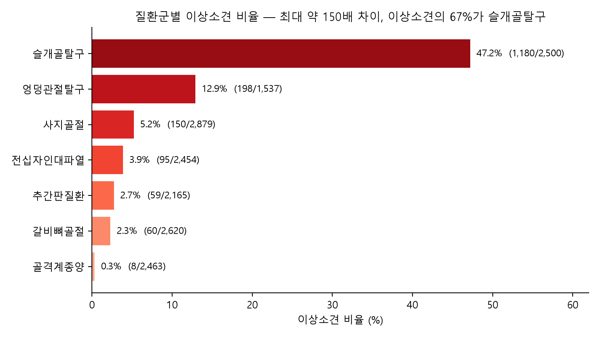

# 멀티모달 AI를 활용한 동물병원 판독 자동화 및 보호자 맞춤 설명문 제공 서비스

동물병원 X-ray 판독 AI의 계약 갱신율 하락(94% → 81%) 문제를 풀기 위해, X-ray · 혈액검사 · 투약 기록을 개체 단위로 묶어 수의사에게는 판독 초안을, 보호자에게는 쉬운 설명문을 제공하는 구독형 서비스를 기획하고 실데이터로 필요성을 검증한 팀 프로젝트이다.

- **팀** 5팀 E-Sight (김지영(팀장) · 전은지 · 신혜원 · 엄태은 · 이지희)
- **기간** 2026.09 — 2026.10
- **내가 맡은 역할** 특성요인도 · 변수정의서 · 분석계획서 설계, 최종 발표 1부(추진배경 · 서비스 제안)

## 핵심 내용

1. **인자 설계** — 영상, 혈액검사, 처방, 개체 정보, 법 · 규제까지 11개 영역에서 528개 인자를 뽑고, 수집성 평가로 104개를 "즉시 착수" 대상으로 분류했다.
2. **범위 재설계** — 실데이터(AI Hub 반려동물 근골격계 X-ray 라벨 16,618장)에서 바로 쓸 수 있는 변수는 12개뿐이었다. 목표 변수와 층별화 변수 19개로 분석 범위를 좁히고, 나머지는 서비스 확장 로드맵으로 남겼다.
3. **관련 강도 판단** — 표본이 커서 작은 차이도 유의하게 나오는 문제를 p-value 대신 크래머 V로 판단했다.

## 폴더 구성

| 경로 | 내용 |
|---|---|
| [presentation/E-Sight_최종발표.pptx](presentation/E-Sight_최종발표.pptx) | 최종 발표 자료 (추진배경 수정본) |
| [presentation/E-Sight_발표대본.txt](presentation/E-Sight_발표대본.txt) | 발표 대본과 예상 질의응답 |
| [deliverables/1_데이터수집성평가표.xlsx](deliverables/1_데이터수집성평가표.xlsx) | 528개 인자 수집성 평가 |
| [deliverables/2_변수정의서.xlsx](deliverables/2_변수정의서.xlsx) | 분석에 쓴 변수 정의 |
| [notebooks/esight_label_check.ipynb](notebooks/esight_label_check.ipynb) | 라벨 데이터 분석 (질환군별 이상률, 크래머 V, 병원별 O/E) |
| [figures/](figures/) | 분석 그래프와 추진배경 그래프 |

## 실행 방법

1. AI Hub에서 반려동물 근골격계 데이터를 받아 라벨을 정리한 `musculoskeletal_labels.csv`를 `notebooks/`에 둔다. 원본 데이터와 이 파일은 용량과 AI Hub 데이터 배포 조건을 고려해 포함하지 않았다.
2. `notebooks/esight_label_check.ipynb`를 실행하면 그래프가 `notebooks/figures/`에 저장된다.
